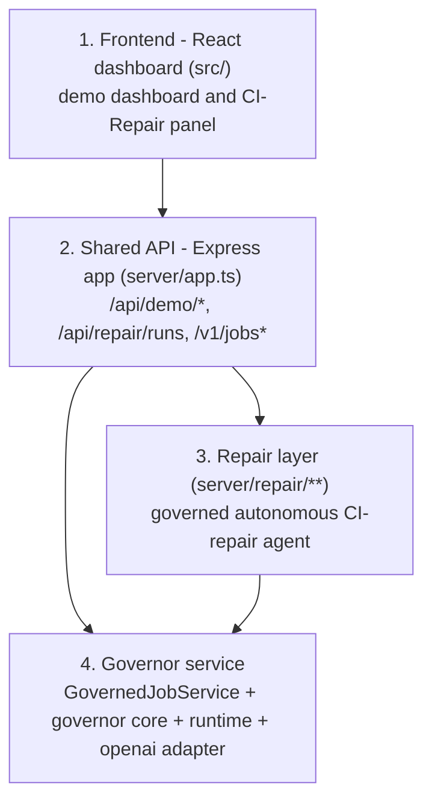

# Governor 207 | Budget-Aware AI Execution

**The budget-aware execution layer for AI agents.**

**Live demo: [governor-207.vercel.app](https://governor-207.vercel.app)**

Built at the Ramp Hackathon in New York City on July 18, 2026. Governor gives
multi-step AI jobs a deterministic cost boundary: count the proposed request,
reserve its conservative maximum cost before dispatch, enforce output limits,
and reconcile reported usage against policy.

This repository contains a working proof of concept for deterministic,
per-job model-cost enforcement. It counts a proposed OpenAI Responses API
request, reserves its conservative maximum list-price cost before dispatch,
caps output, and settles provider-reported usage against a fixed policy.
The multi-step pull-request review workflow is integration-tested with a
scripted fake Responses provider; it has not made a live OpenAI call.

The terminal CLI and versioned HTTP API are the primary POC customer
experience. The optional React dashboard is a scripted mechanism walkthrough;
its scenarios, usage, receipts, timing, quality results, and costs are
deterministic synthetic fixtures. No external model calls produced them.

## Current truth boundary

- The enforcement kernel, provider adapter, governed executor, artifact store,
  multi-step review workflow, governed jobs API, terminal CLI, demo API, and
  dashboard are implemented and tested.
- `POST /v1/jobs` creates an in-memory budget ledger. Each
  `POST /v1/jobs/:jobId/responses` request is preflighted and, if admitted,
  reserved before one dispatch. Terminal provider usage settles the
  reservation.
- A `request_id` is an idempotency key within its job. Concurrent or later
  submissions with the same ID and response intent share the stored outcome
  without another provider dispatch; reuse for a different intent returns
  `409 REQUEST_ID_CONFLICT`. The response retrieval route is
  `GET /v1/jobs/:jobId/responses/:requestId`.
- Genuine post-dispatch ambiguity returns `202`, retains the full reservation,
  and locks the job in `reconciliation_required`. Reconciliation is required
  before more work, but the POC has no public reconciliation endpoint.
- Final output must be explicitly accepted or rejected through
  `POST /v1/jobs/:jobId/finalize`.
- The OpenAI adapter permits local function tools only, disables parallel tool
  calls and provider storage, and never retries an ambiguous model request.
- Admission records a canonical context hash, binds model, default request
  tier, processing region, provider, and rate-card version to the reservation,
  then records the exact dispatched-request hash. Settlement rechecks the
  provider response model and tier.
- A completed final response remains pending until the application explicitly
  validates its output and closes the job as accepted or rejected.
- The built-in PR-review workflow suppresses equivalent tool retries only
  against the same trusted, immutable repository snapshot; transient failures
  do not consume that retry budget. The generic jobs API does not classify
  tool retries.
- The dashboard does not show measured usage, a real benchmark, customer
  savings, invoice control, or production readiness.
- The ledger and active workflow state are single-process memory. A restart
  loses them, and there is no transactional cross-process coordination or
  recovery.
- The governed API is an unauthenticated localhost POC, not a public,
  multi-tenant service.
- Static and predictive-shadow demo arms have identical cost. Prediction has
  not established incremental value and cannot change execution.
- The strongest current claim is deterministic budget middleware, not cost
  forecasting.

See [`docs/POC_FINDINGS.md`](docs/POC_FINDINGS.md) for the adversarial verdict
and next falsification experiment. The full product and technical design is in
[`docs/GOVERNOR.md`](docs/GOVERNOR.md). The governed CI-repair
feature has its own design spec in [`docs/CI_REPAIR.md`](docs/CI_REPAIR.md).

## Architecture

Governor is organized as four layers. A request flows top to bottom, and every
model call, whether it originates in the CI-repair agent or the generic jobs
API, is enforced by the same governor engine at the bottom.



1. **Frontend** (`src/`). A React dashboard: a deterministic demo walkthrough,
   plus a CI-Repair panel that triggers repair runs. It talks only to the shared
   API over HTTP.
2. **Shared API** (`server/app.ts`). An Express app that applies security
   headers, a `256kb` body limit, and a uniform JSON error envelope
   (`{ "error": { "code", "message", "details?" } }`). It exposes the demo
   routes (`/api/demo/*`), the CI-repair entrypoint (`/api/repair/runs`), and
   the governor's versioned job routes (`/v1/jobs*`).
3. **Repair layer / "our layer"** (`server/repair/**`). A governed autonomous
   CI-repair agent. It copies a broken fixture into an isolated sandbox, reads
   test evidence, proposes patches through custom tools, re-runs tests, and is
   bounded by a per-job spend budget. It never enforces cost itself; it drives
   the governor engine for every model call.
4. **Governor service** (`server/jobs/service.ts` `GovernedJobService` +
   `server/governor/**` core + `server/runtime/**` + `server/openai/**`). The
   deterministic budget-enforcement engine. It pre-authorizes each request's
   worst-case list-price cost against a fixed ceiling before dispatch and
   reconciles actual provider usage afterward. It is exposed over HTTP as
   `/v1/jobs`, and its governed-execution path is what the repair layer calls
   per model call.

### Cost enforcement flow

Inside the governor, every model request passes through the same deterministic
pipeline before and after dispatch:

```text
COUNT input tokens   -> exact proposed-input preflight
PRICE worst case     -> conservative list-price ceiling for the request
RESERVE              -> hold that amount atomically against the job ceiling
CAP output           -> max_output_tokens sized to the safe remainder
DISPATCH             -> one in-flight response, no automatic retries
SETTLE               -> reconcile provider-reported usage; release the remainder
```

A request is never dispatched before its worst-case cost is reserved, and
settled cost plus outstanding reservations can never exceed the job ceiling.

## CI-Repair

The CI-Repair feature turns TokenGovernor from a read-only PR-review demo into a
governed autonomous build-repair agent. Given a broken fixture repository, the
agent inspects files, reads failing-test output, applies minimal patches, and
re-runs tests in a loop until the build is green — while the governor reserves,
caps, and settles the cost of every model call and refuses any call that would
exceed the per-job budget. CI-repair is the wedge argued for in
[`docs/POC_FINDINGS.md`](docs/POC_FINDINGS.md): a machine-verifiable outcome
(tests pass/fail) with repeated attempts, where reserve/cap/settle and
retry-suppression earn their value.

### Triggering a run

Send a `POST /api/repair/runs` request. The body selects a fixture and a
provider mode:

```bash
curl -sS http://127.0.0.1:8787/api/repair/runs \
  -H 'Content-Type: application/json' \
  -d '{ "fixtureId": "broken-sum", "mode": "fake" }'
```

Provider modes control where model calls actually run:

- `fake` — deterministic scripted provider; makes no network call ($0, default).
- `hybrid` — real OpenAI input-token preflight (free) plus scripted
  generation ($0).
- `live` — real OpenAI generation (requires `OPENAI_API_KEY`).

### Response shape

The endpoint returns a governed result describing the run at a high level:

- `status` — `repaired` or `not_repaired`.
- `evaluation` — the sealed ground-truth verdict (target tests pass plus the
  change policy), computed independently of the agent.
- `finalText` — the agent's summary of the fix (or of why it could not repair).
- `trace` — the governed trace of responses, tool calls, and any suppressed
  retries, each with a ledger snapshot.
- reconciled spend — the run's `settledMicroUsd` (integer micro-USD),
  reported on the governed ledger snapshot in the result.

## Implemented POC

- Versioned integer-micro-USD rate cards and conservative reservation math
- Exact input-token preflight through `POST /v1/responses/input_tokens`
- One unresolved response at a time, output caps, response limits, and a
  protected final-answer reserve
- Canonical context and dispatched-request hashes with pinned pricing identity
- Explicit application validation after final-response settlement
- Safe-stop handling for transport ambiguity, missing usage, and usage mismatch
- Trusted-state retry suppression and bounded test-log reduction
- A multi-step review loop exercised through a scripted fake provider
- A terminal CLI and HTTP API for creating, running, retrieving, inspecting,
  and finalizing governed jobs
- Idempotent response submission with stored-outcome replay and conflict
  detection
- Memory and file-backed content-addressed raw artifact stores
- Three deterministic scenarios across hard-cap, static, and predictive-shadow
  controllers
- Responsive dashboard with trace playback, accounting, interventions,
  receipts, and a quality-gated mechanism comparison

## Repository map

- `server/app.ts`: shared Express API (demo, repair, and governed-job routes)
- `server/governor/`: policy, cost, reservation, retry, risk, and log reduction
- `server/openai/`: restricted no-retry Responses API adapter and fake/hybrid/live provider factory
- `server/runtime/`: integrated count, reserve, dispatch, and settle flow
- `server/jobs/`: in-memory governed-job API service and exact USD conversion
- `server/repair/`: governed CI-repair agent (sandbox, custom tools, budget tools, sealed evaluation, workflow)
- `server/artifacts/`: bounded content-addressed artifact persistence
- `server/demo/`: deterministic scenarios, traces, and reconciled receipts
- `cli/`: terminal client for live governed jobs and scripted demo traces
- `plugins/token-governor/`: Codex launcher policy, prompt gate, and skill
- `src/`: React operations dashboard and CI-Repair panel
- `api/`: public Vercel entry point for deterministic demo routes
- `public/brand/`: selected Governor identity asset
- `tests/` and `e2e/`: unit, integration, API, and browser coverage
- `docs/`: design and POC findings

The intended dependency direction is:

```text
CLI -> HTTP API -> jobs/runtime -> governor core
                         |
                         +-> OpenAI adapter
```

`server/governor/**` does not import the HTTP, CLI, runtime, or provider
adapters. `server/main.ts` is the executable API entry point;
`server/index.ts` is an importable, side-effect-free library facade.

## Production deployment

The Vercel deployment exposes the dashboard, deterministic `/api/demo/*`
walkthrough, and fake-only `/api/repair/runs` fixture. It makes no external
model calls and does not present the in-memory `/v1/jobs` POC as a durable
hosted service. Run the local service for governed-job and optional
live-provider experiments.

## Run locally

Requires Node.js 18 or later.

```bash
npm ci
npm start
```

The core commands are `npm run dev` (API on `http://127.0.0.1:8787` plus the
dashboard on `http://127.0.0.1:5173`), `npm test` (full suite), and
`npm run build` (typecheck and production bundle).

In another terminal, inspect the service and play a no-key synthetic trace:

```bash
npm run governor -- health
npm run governor -- demo \
  --scenario large-failing-log \
  --controller static
```

Create and inspect a real governed job ledger:

```bash
npm run governor -- job create --budget 0.075
npm run governor -- job show job_replace_me
```

To dispatch live responses, start the server with `OPENAI_API_KEY` configured.
Jobs are process-local, so create the live job after that server starts:

```bash
OPENAI_API_KEY=... npm start
```

In another terminal, create the job, set its returned ID, submit a response, and
retrieve the stored outcome:

```bash
npm run governor -- job create --budget 0.075
JOB_ID=job_replace_me
npm run governor -- response create \
  --job "$JOB_ID" \
  --request review:work:1 \
  --phase work \
  --input "Review this change"
curl -sS "http://127.0.0.1:8787/v1/jobs/${JOB_ID}/responses/review%3Awork%3A1"
```

The API accepts decimal USD as strings and returns both exact integer
micro-USD and six-decimal USD fields. `minimum_output_tokens` (CLI
`--min-output`) is an admission floor: the call is denied if the affordable
output cap falls below it. It does not require or guarantee that the model
generates that many tokens.

Equivalent-retry classification belongs to the built-in PR-review workflow.
The generic jobs API does not expose that workflow-specific policy.

A completed final response leaves the job in `validation_required` until the
application explicitly accepts or rejects it. To run the API and optional
dashboard together instead, use `npm run dev`; the dashboard is at
`http://127.0.0.1:5173` and the API is at `http://127.0.0.1:8787`.

```bash
npm run test:core
npm run test:api
npm run typecheck
npm run build
npm run test:e2e
```

The terminal-first HTTP surface is:

- `POST /v1/jobs`
- `GET /v1/jobs/:jobId`
- `POST /v1/jobs/:jobId/responses`
- `GET /v1/jobs/:jobId/responses/:requestId`
- `POST /v1/jobs/:jobId/finalize`

The separate application surface is:

- `GET /api/health`
- `GET /api/demo/catalog`
- `POST /api/demo/runs`
- `POST /api/repair/runs`
