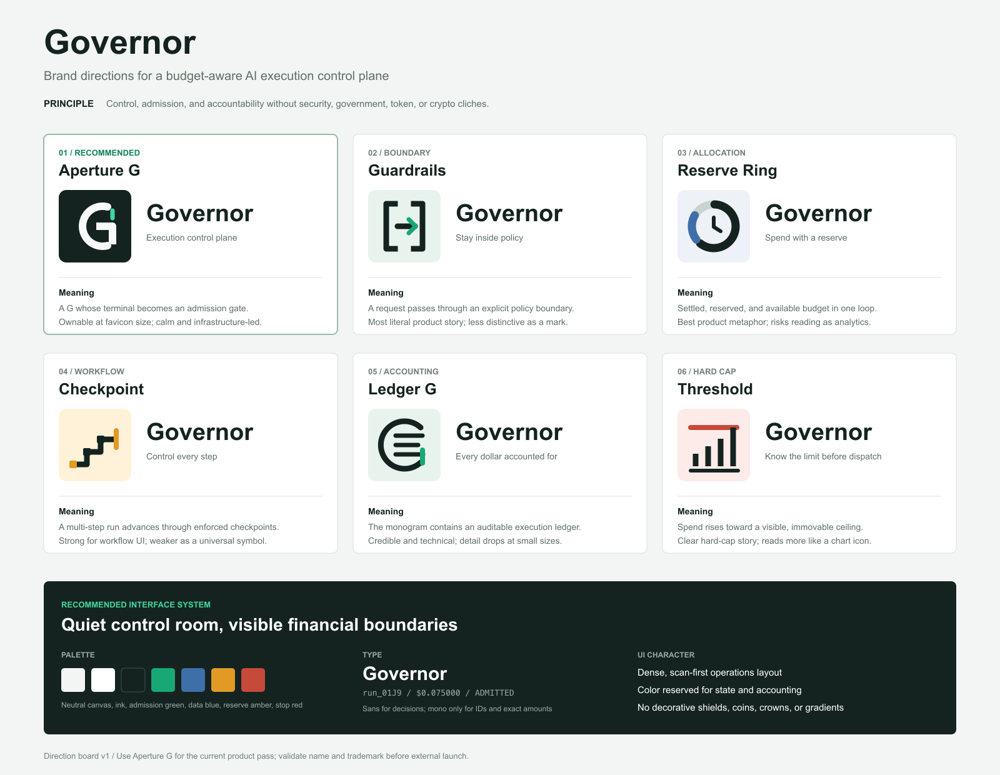

# Governor Brand Directions

The product name is **Governor**. Internal compatibility identifiers such as
`token-governor`, `token_governor.job`, and the existing CLI filename can remain
unchanged until a deliberate API migration.

The interactive design picker is available at `/brand` while the local
development server is running. It includes ten complete identity directions,
category filters, a three-way comparison, local choice persistence, and a
downloadable decision record.

## Recommended Direction: Aperture G

Use the Aperture G for the current product pass. It combines the initial with
the product's core action: a request reaches a boundary and is admitted only
when policy allows it. It stays recognizable at favicon size and avoids making
the product look like security software, a government service, or a crypto
tool.

The green terminal is the gate. Keep that accent functional and sparse rather
than turning the entire interface green.

## Other Directions

| Direction | Product idea | Tradeoff |
| --- | --- | --- |
| Guardrails | Requests stay inside explicit policy boundaries | Very clear, but less ownable |
| Reserve Ring | Settled, reserved, and available budget | Strong metaphor, but can read as analytics |
| Checkpoint | Multi-step execution with enforced decisions | Good for workflow UI, weaker as a master brand |
| Ledger G | Auditable accounting inside the monogram | Credible, but too detailed at small sizes |
| Threshold | Spend rising toward a hard cap | Clear for one feature, narrow for the full product |

## Interface Direction

- Treat the dashboard as a quiet control room: dense, scan-first, and explicit.
- Use ink for primary commands, green for admission and healthy state, blue for
  measured data, amber for reserves, and red for stops.
- Use sans-serif type for decisions and labels. Reserve monospace for IDs,
  exact amounts, hashes, and machine states.
- Keep surfaces mostly white on a cool neutral canvas. Color should explain
  state or accounting, not decorate sections.
- Avoid shields, coins, crowns, government seals, gradients, and crypto motifs.

## Assets

- `public/brand/governor-mark.svg`: selected app and favicon mark
- `public/brand/governor-aperture.svg`: selected mark without a background
- `public/brand/governor-guardrails.svg`
- `public/brand/governor-reserve-ring.svg`
- `public/brand/governor-checkpoint.svg`
- `public/brand/governor-ledger.svg`
- `public/brand/governor-threshold.svg`
- `public/brand/governor-brand-board.svg`
- `public/brand/governor-brand-board.png`

Before external launch, run naming and trademark checks for both `Governor` and
the selected mark.
